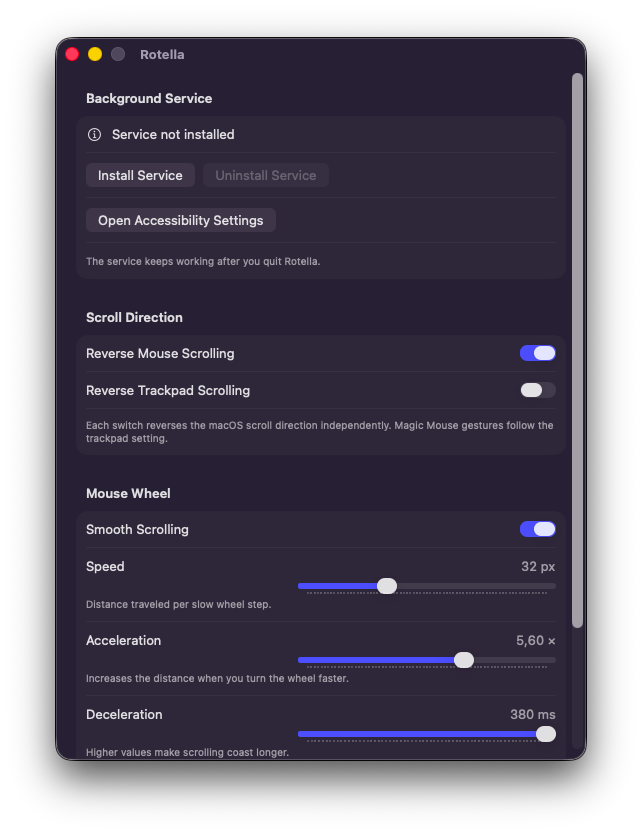
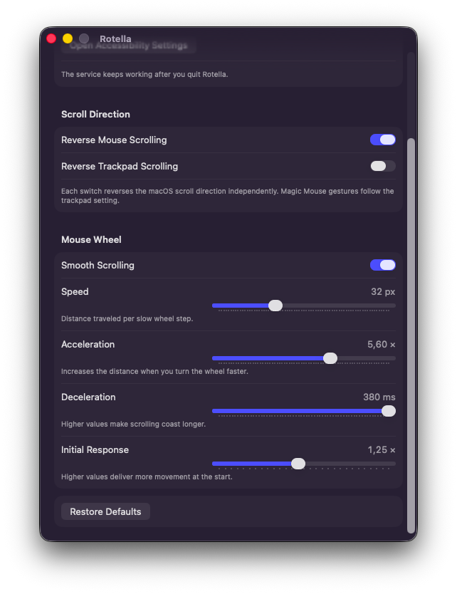

# Rotella — Another App for Smooth Scrolling


Rotella is a macOS utility for smoother mouse-wheel scrolling and independent scroll directions for your mouse and trackpad. Once you install the background service, it starts at login and keeps working when you close or quit the app.

## What it does

- Reverse mouse and trackpad scrolling independently, relative to the macOS setting.
- Smooth discrete wheel steps and tune speed, acceleration, deceleration, and initial response.
- Install or uninstall the background service from the app window.

 

*Rotella settings with service controls, independent scroll directions, and mouse-wheel tuning.*

## Installation guide

Requires macOS 13 or later on Intel or Apple Silicon. Install the Xcode Command Line Tools if needed:

```sh
xcode-select --install
```

Download or clone this repository, then run these commands from its root:

```sh
make check
open build
```

Drag **Rotella.app** from the build folder to **Applications** and open it there. The local build is signed ad hoc and does not need a Developer ID.

1. If Rotella detects a service from an earlier version, choose **Remove Previous Service**.
2. Choose **Install Service**. If macOS requests approval, choose **Open Login Items** and allow Rotella under **System Settings → General → Login Items & Extensions**.
3. Choose **Open Accessibility Settings** to go to **System Settings → Privacy & Security → Accessibility** and enable the **Rotella.app** you copied to Applications. If an entry from an earlier build is already present and Rotella still reports that it needs permission, remove that entry and add the current app again.

## How to use it

Open Rotella whenever you want to adjust settings. In **Scroll Direction**, set the mouse and trackpad switches independently. Under **Mouse Wheel**, enable **Smooth Scrolling** and try the sliders in a long page as you make adjustments. A longer deceleration makes the wheel coast longer after the last step.

Devices that send continuous gesture events, such as Magic Mouse, follow the trackpad direction setting. The smoothing controls apply to wheels that send discrete steps. Scrolling with modifier keys uses the macOS behavior.

Choose **Uninstall Service** to stop it and remove it from automatic startup.

## Build a universal archive

```sh
make package ARCHS="arm64 x86_64"
```

The archive is written to `build/Rotella-macOS.zip`. For public distribution of the compiled app through GitHub Releases, sign with Developer ID and notarize it with Apple. [Apple notarization guide](https://developer.apple.com/documentation/security/notarizing-macos-software-before-distribution)
